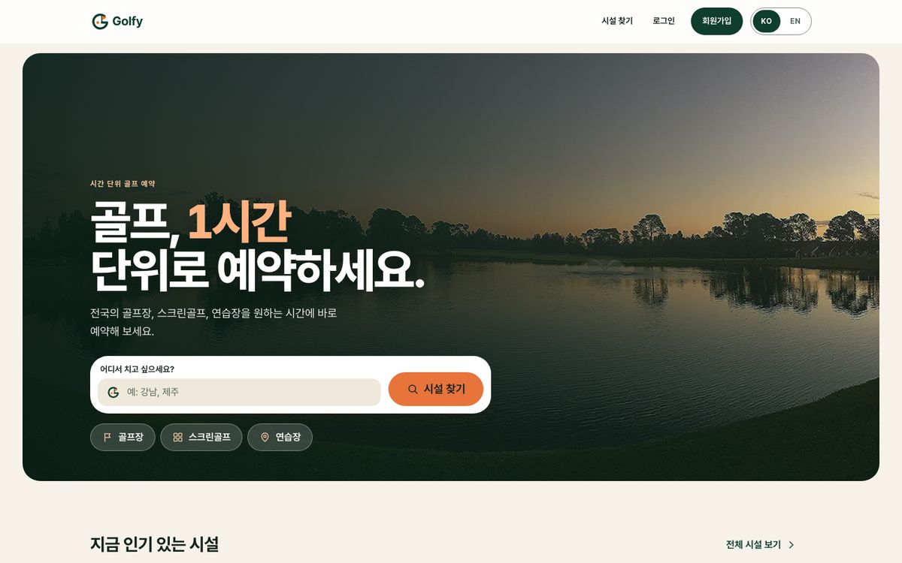
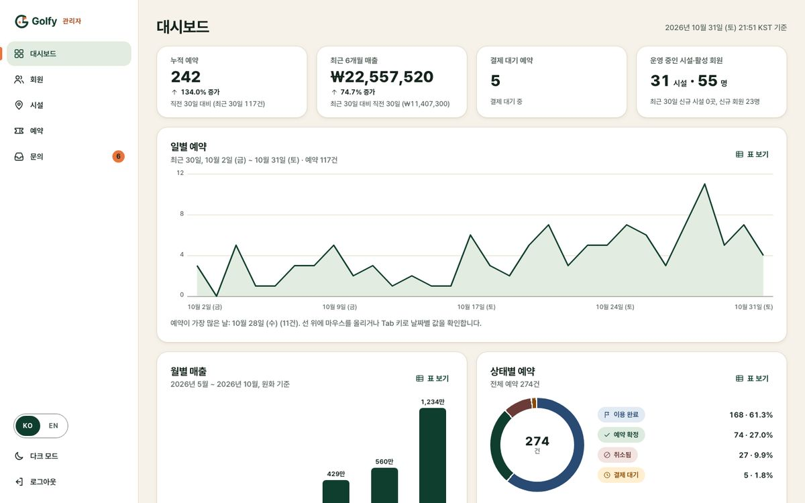
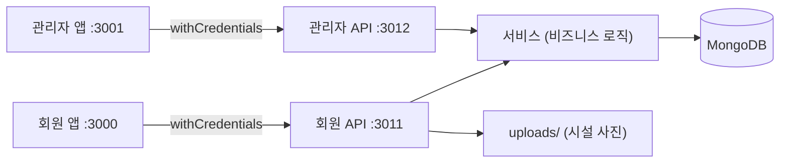
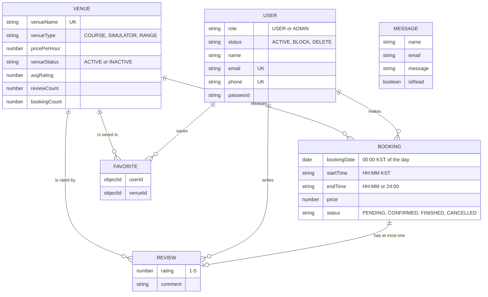

<p align="center"></p>

# Golfy 백엔드

[English](README.md) · [한국어](README.ko.md)

[](https://github.com/avazqudratovv-mit/Golfy-backend/actions/workflows/ci.yml)  

**Golfy**는 골프장, 스크린골프, 골프연습장을 1시간 단위로 예약하는 서비스의 API입니다.
포트폴리오 프로젝트이며, 시설은 모두 가상의 데모 데이터이고 결제는 시뮬레이션입니다.

## 세 앱을 10줄로 보기

1. **golfy-backend**(이 저장소): 하나의 TypeScript 코드베이스에서 Express 서버 두 개를 하나의 MongoDB와 함께 운영합니다.
2. **회원 API**(`:3011`)는 회원 앱을 위한 API입니다: 시설 탐색, 빈 시간 확인, 예약, 결제(시뮬레이션), 리뷰, 즐겨찾기.
3. **관리자 API**(`:3012`)는 직원용 앱을 위한 API입니다: 대시보드, 회원, 시설, 예약, 문의함.
4. **[golfy-frontend](https://github.com/avazqudratovv-mit/Golfy-Frontend-User)**(`:3000`)는 회원용 웹 앱입니다(React, 기본 한국어 + EN 전환).
5. **[golfy-admin](https://github.com/avazqudratovv-mit/Golfy-Frontend-Admin)**(`:3001`)은 직원용 대시보드입니다(React, KO | EN).
6. 두 앱 모두 CRA + TypeScript, 직접 작성한 CSS와 같은 디자인 토큰을 사용하며 이 API와만 통신합니다.
7. 인증은 httpOnly 쿠키의 JWT입니다. 앱은 `withCredentials`만 사용하고 토큰을 읽지 않습니다.
8. 예약 날짜는 **한국 표준시(KST)** 달력 날짜이며 KST 00:00으로 저장됩니다. 시간(HH:MM)은 KST 기준입니다.
9. `npm run seed`로 시설 24곳, 회원 40명, 예약 250건, 리뷰 150건을 채웁니다(사진은 위키미디어 공용).
10. 모두 로컬에서 실행됩니다: `docker compose up`(API + Mongo + 시드) 또는 `npm run start:dev`. 테스트에는 DB가 필요 없습니다.

| 회원 앱 (KO, 데스크톱) | 관리자 대시보드 (KO, 데스크톱) |
| --- | --- |
|  |  |

## 주요 기능

- 시설 검색, 필터, 정렬, 페이지 처리, 평점 분포, 비슷한 시설, 즐겨찾기
- 60분 결제 보류, 중복 예약 방지, 동시 요청에도 안전한 저장
- 예약 상태 머신, 이용한 예약당 리뷰 1개, 평점 자동 재계산
- 관리자: KPI와 차트, 회원 차단/삭제, 시설 등록·수정·운영 전환, 예약 목록, 문의함
- 보안: httpOnly 쿠키, CORS 허용 목록, helmet, 요청 본문 크기 제한, 요청 횟수 제한, 관리자 가입 잠금
- 자동 테스트 76개(Jest + supertest + 메모리 MongoDB), GitHub Actions CI, 로컬 Docker

## 기술 스택

Node 20/22, Express 4, TypeScript, MongoDB + Mongoose 6, JWT, bcryptjs, multer, helmet, Jest, supertest, mongodb-memory-server, ESLint, Docker(로컬 전용)

## 구조



폴더 구조는 [영문 README](README.md#architecture)와 같습니다(`controllers` HTTP 계층, `models/*.service.ts` 비즈니스 로직, `schema` Mongoose, `libs` 유틸, `seed.ts`, `seed-assets/venues/` 사진, `tests/`).

### 데이터 모델



## 예약 규칙

- **금액**은 서버에서 계산합니다: `1시간 요금 x 이용 시간`. 클라이언트는 금액을 보내지 않습니다. 금액 단위는 원(₩)입니다.
- **상태 머신:** `PENDING -> CONFIRMED -> FINISHED`, 그리고 `PENDING | CONFIRMED -> CANCELLED`. `FINISHED`와 `CANCELLED`는 최종 상태이며, 같은 상태로의 변경은 아무 일도 하지 않습니다.
- **FINISHED는 종료 시간 이후에만** 가능합니다(예약일의 KST 기준). `24:00`은 그날의 끝입니다.
- **결제 보류:** 결제 전(`PENDING`) 예약은 **60분 동안** 해당 시간을 막고, 이후에는 다시 비워집니다. 보류가 끝난 예약을 확정하려 하면 시간을 다시 확인하고, 다른 사람이 예약했다면 `409`를 반환합니다.
- **중복 불가:** `CONFIRMED`, `FINISHED`, 유효한 `PENDING` 예약은 같은 시설·같은 KST 날짜의 겹치는 시간을 거부합니다. 끝과 시작이 맞닿는 것(10:00~11:00, 11:00~12:00)은 허용됩니다. 저장 후 다시 확인하므로 동시 요청에서도 한 건만 성공합니다.
- **KST:** API는 `YYYY-MM-DD`(또는 ISO 시각)를 KST 달력 날짜로 해석합니다. `bookingDate`는 KST 00:00(전날 UTC 15:00)으로 저장하며, 시간대 없는 날짜·시각은 서버 시간대가 아니라 KST로 읽습니다. UTC 자정으로 저장된 기존 데이터는 같은 달력 날짜로 해석됩니다. 대시보드 집계는 `Asia/Seoul` 기준입니다.
- **리뷰:** 예약당 1개, 본인의 `FINISHED`(또는 이미 이용 시간이 끝난 `CONFIRMED`) 예약에만 작성할 수 있습니다. 작성할 때마다 시설의 `avgRating`, `reviewCount`를 다시 계산합니다.
- **결제는 시뮬레이션:** "결제"는 예약을 `CONFIRMED`로 바꿀 뿐이며 결제 대행사는 없습니다.

## 실행 방법

```bash
npm install
cp .env.example .env     # MONGO_URL, SECRET_TOKEN 설정
npm run seed:reset       # 데모 데이터 + 사진
npm run start:dev        # 회원 API  -> http://localhost:3011
npm run start:admin:dev  # 관리자 API -> http://localhost:3012
```

그 밖의 명령: `npm run typecheck`, `npm run lint`, `npm run build`, `npm test` (`TZ=America/Los_Angeles npm test`, `TZ=Asia/Seoul npm test`로 실행해도 결과가 같습니다).

**Docker(로컬 개발 전용):** `docker compose up --build`로 MongoDB를 띄우고, 시드를 한 번 실행한 뒤 두 API(3011, 3012)를 시작합니다. React 앱은 각 저장소에서 `yarn start`로 실행합니다. `docker compose down -v`로 데이터를 지웁니다. 배포(호스팅) 설정은 포함하지 않습니다.

### 환경 변수

[영문 README의 표](README.md#environment-variables)와 같습니다. 핵심만 정리하면: `MONGO_URL`, `SECRET_TOKEN`(필수), `CORS_ORIGINS`(허용할 브라우저 출처; 비우면 개발 환경에서만 로컬 앱 허용), `COOKIE_SAMESITE`(기본 `lax`), `COOKIE_SECURE`(개발 기본 `false`, production 기본 `true`), `TRUST_PROXY`(프록시 뒤에서 실제 IP를 쓰려면 설정), `ADMIN_SIGNUP_SECRET`(설정하면 관리자 가입 시 필요, `GET /signup-info`로 관리자 앱이 확인), `SEED_ADMIN_PASSWORD`.

## 데모 데이터

`npm run seed`는 데모 데이터를 추가하고(이미 있으면 건너뜀), `npm run seed:reset`은 **데모 데이터만**(`@seed.golfy.dev` 이메일과 `src/seed.ts`의 시설 이름) 지우고 다시 만듭니다. 사진 72장은 `seed-assets/venues/`에서 `uploads/venues/seed/`로 복사됩니다. 금액은 원 단위입니다(시드의 `price: 78`은 ₩78,000). 사진 출처: [CREDITS.md](CREDITS.md).

| 구분 | 이메일 | 비밀번호 |
| --- | --- | --- |
| 관리자 | `admin@seed.golfy.dev` | `Admin123!` (또는 `SEED_ADMIN_PASSWORD`) |
| 관리자 | `admin.hana@seed.golfy.dev` | 동일 |
| 회원 | `minjun@seed.golfy.dev` | `Password123!` |
| 회원 | `olivia@seed.golfy.dev` | `Password123!` |

## API

엔드포인트 표는 [영문 README](README.md#api)와 같습니다. 오류 응답은 `{ code, message }`(영어)이며 앱이 알려진 메시지를 한국어로 바꿔 보여 줍니다.

## 설계 결정과 트레이드오프

- **규칙은 서비스에, 컨트롤러는 얇게.** supertest로 HTTP를 통해 쉽게 테스트할 수 있습니다.
- **예약 날짜를 하나의 시각(KST 00:00)으로 저장**하면 범위 조회가 단순하고 별도 필드가 필요 없습니다. KST에는 서머타임이 없어 단순 계산으로 정확하며, 모든 처리는 `libs/utils/kst.ts` 한 곳에 있습니다.
- **트랜잭션 없음:** 겹침 확인 → 저장 → 재확인 후 패배한 요청은 삭제합니다. 단일 MongoDB에서는 충분히 안전하고 단순합니다. 다음 단계는 시설·날짜·시간 단위의 유니크 인덱스입니다.
- **토큰은 쿠키에만.** 앱이 토큰을 볼 수 없어 XSS로 탈취되지 않습니다. 대신 다른 사이트로 배포할 때는 `COOKIE_SAMESITE=none`과 HTTPS가 필요합니다.
- **API는 추가만:** 목록은 페이지 파라미터가 없으면 배열 그대로 응답하고, 새 필드·엔드포인트는 기존 클라이언트를 깨뜨리지 않습니다.

## 한계

- 결제는 시뮬레이션입니다(결제 대행사·환불 없음). 데모 데이터만 있으며, DB에 이미 있던 기존 시설 10곳과 회원 17명은 시드가 건드리지 않습니다.
- 요청 횟수 제한은 프로세스 메모리 기반입니다(여러 인스턴스에서는 공유 저장소가 필요).
- Mongoose 6과 Express 4를 의도적으로 유지했고, 남은 `npm audit` 항목은 개발 도구(jest, nodemon)입니다.
- OpenAPI 문서, 이메일 알림, 취소 기한 규칙은 없습니다.

## 다음에 할 일

1. 확인 후 재확인 대신 (시설 + KST 날짜 + 시간) 유니크 인덱스
2. Express 5, Mongoose 8로 업그레이드, 요청 제한을 Redis로 교체
3. 라우트에서 OpenAPI 명세 생성, 두 앱과의 계약 테스트
4. 기존 "확정" 단계 뒤에 실제 결제 대행사 연동, 환불·취소 규정
5. 이메일/SMS 알림, 보류 만료를 위한 백그라운드 작업
