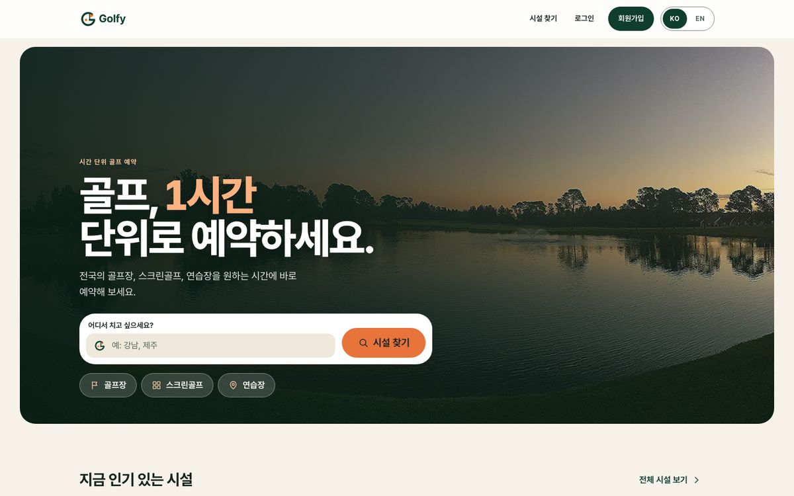
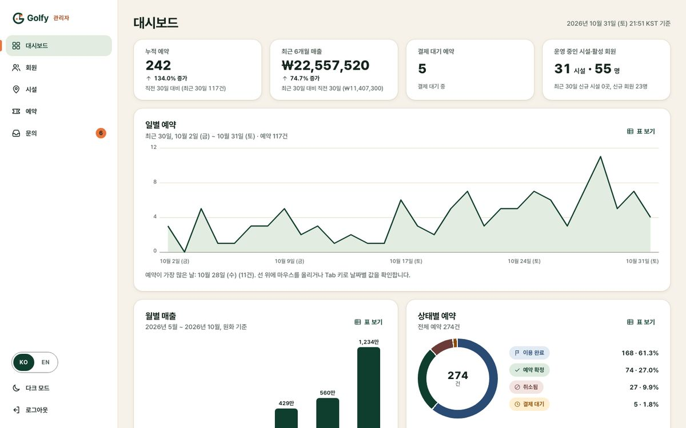
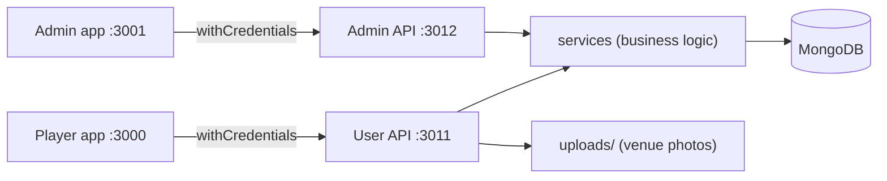
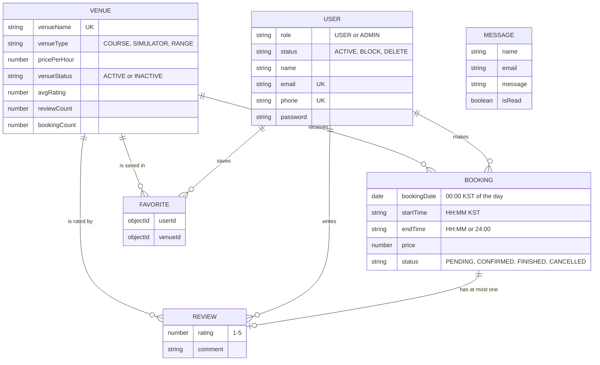

<p align="center"></p>

# Golfy backend

[English](README.md) · [한국어](README.ko.md)

[](https://github.com/avazqudratovv-mit/Golfy-backend/actions/workflows/ci.yml)  

API for **Golfy**, an hourly golf-venue booking platform for Korea (golf courses, screen-golf simulators and driving ranges).
This is a portfolio project: the venues are fictional demo data and the payment is simulated.

## The three apps in 10 lines

1. **golfy-backend** (this repo): one TypeScript codebase, two Express servers on one MongoDB.
2. The **user API** (`:3011`) serves the player app: browse venues, see free hours, book, "pay", review, favourite.
3. The **admin API** (`:3012`) serves the staff app: dashboard, users, venues, bookings, contact inbox.
4. **[golfy-frontend](https://github.com/avazqudratovv-mit/Golfy-Frontend-User)** (`:3000`) is the player web app (React, Korean by default with an EN toggle).
5. **[golfy-admin](https://github.com/avazqudratovv-mit/Golfy-Frontend-Admin)** (`:3001`) is the staff dashboard (React, KO | EN).
6. Both apps are plain CRA + TypeScript with hand-written CSS and the same design tokens; they only talk to this API.
7. Auth is a JWT in an httpOnly cookie; the apps use `withCredentials`, never read the token.
8. A booking day is a **Korea Standard Time** calendar day stored as 00:00 KST; slot times are KST wall-clock.
9. `npm run seed` fills MongoDB with 24 venues, 40 players, 250 bookings and 150 reviews (photos from Wikimedia Commons).
10. Everything runs locally: `docker compose up` (API + Mongo + seed) or `npm run start:dev`; tests need no database.

| Player app (KO, desktop) | Admin dashboard (KO, desktop) |
| --- | --- |
|  |  |

## Features

- Venue search, filters, sorting and pagination; rating breakdown; similar venues; favourites.
- Hourly availability with a 60-minute payment hold, overlap protection and a race-safe insert.
- Booking state machine, one review per played booking, automatic rating recompute.
- Admin: KPIs and charts, user block/delete, venue create/edit/activate, booking list, contact inbox.
- Security: httpOnly cookies, CORS allow-list, helmet, body limit, rate limits, admin signup lock.
- 76 automated tests (Jest + supertest + in-memory MongoDB), GitHub Actions CI, local Docker.

## Tech stack

Node 20/22, Express 4, TypeScript, MongoDB + Mongoose 6, JWT, bcryptjs, multer, helmet, Jest, supertest, mongodb-memory-server, ESLint, Docker (local only).

## Architecture



```
src/
  server.ts / serverAdmin.ts   boot + DB connection
  app.ts / appAdmin.ts         express setup (helmet, CORS, parsers, uploads, /health)
  router.ts / routerAdmin.ts   route tables
  controllers/                 HTTP layer: parse request, call a service, shape the response
  models/                      services: all business logic (*.service.ts)
  schema/                      Mongoose models + indexes
  libs/                        enums, types, utils (config, errors, rate limit, uploads, kst.ts, booking.ts)
  seed.ts                      demo data
seed-assets/venues/            72 WebP demo photos (copied to uploads/ by the seed)
tests/                         Jest suites + helpers (in-memory MongoDB)
CREDITS.md                     author and licence of every photo
```

### Data model



## Booking rules

- **Price** is computed on the server: `pricePerHour x hours`. The client never sends a price. Prices are Korean won.
- **State machine:** `PENDING -> CONFIRMED -> FINISHED`, and `PENDING | CONFIRMED -> CANCELLED`. `FINISHED` and `CANCELLED` are final. Setting the same status is a no-op.
- **FINISHED only after the end time** (KST wall-clock on the booking's day). `24:00` means the end of that day.
- **Hold:** an unpaid `PENDING` booking blocks its slot for **60 minutes**, then the slot is free again. Confirming a booking whose hold ran out re-checks the slot and answers `409` if somebody else took it.
- **No overlaps:** `CONFIRMED`, `FINISHED` and live `PENDING` bookings reject overlapping slots on the same venue and KST day. Touching ends (10:00-11:00 and 11:00-12:00) are fine. After inserting, the service re-checks, so with parallel requests exactly one wins.
- **KST:** the API accepts `YYYY-MM-DD` (or an ISO instant) and reads it as a KST calendar day. `bookingDate` is stored as 00:00 KST (15:00 UTC the day before); a date-time without a zone is read as KST, never the server's zone. Old records stored at UTC midnight map to the same calendar day. Dashboard grouping uses `Asia/Seoul`.
- **Reviews:** one per booking, only for your own booking that is `FINISHED` (or `CONFIRMED` and already played). The venue `avgRating` and `reviewCount` are recomputed after each review.
- **Payment is simulated:** "paying" sets the booking to `CONFIRMED`. There is no payment provider.

## Setup

```bash
npm install
cp .env.example .env     # set MONGO_URL and SECRET_TOKEN
npm run seed:reset       # demo data + photos
npm run start:dev        # user API  -> http://localhost:3011
npm run start:admin:dev  # admin API -> http://localhost:3012
```

Other commands: `npm run typecheck`, `npm run lint`, `npm run build`, `npm test` (also try `TZ=America/Los_Angeles npm test` and `TZ=Asia/Seoul npm test`: the results are identical).

**Docker (local development only):** `docker compose up --build` starts MongoDB, runs the seed once, then starts both APIs on 3011 and 3012. Run the React apps from their repos with `yarn start`. `docker compose down -v` removes the data. There is no hosting configuration in these repos.

### Environment variables

| Name | Default | Purpose |
| --- | --- | --- |
| `MONGO_URL` | required | MongoDB connection string |
| `SECRET_TOKEN` | required | JWT signing secret |
| `PORT` / `ADMIN_PORT` | 3011 / 3012 | server ports |
| `NODE_ENV` | - | `production` makes cookies Secure by default and removes the local CORS defaults |
| `CORS_ORIGINS` | local dev apps outside production, none in production | comma separated origins allowed to call the API with credentials; other origins get no CORS headers |
| `COOKIE_SAMESITE` | `lax` | `lax`, `strict` or `none` (`none` forces Secure) |
| `COOKIE_SECURE` | `false` in dev, `true` in production | Secure flag of the auth cookies (they are always httpOnly) |
| `TRUST_PROXY` | unset | `true`, a hop count or an Express value, so the rate limiter sees the real client IP behind a proxy |
| `ADMIN_SIGNUP_SECRET` | unset | when set, `POST /signup` on the admin API must send it (`x-admin-secret` header or `adminSecret` field). `GET /signup-info` tells the admin app whether it is required. Leave empty only on a local machine. |
| `SEED_ADMIN_PASSWORD` | `Admin123!` | password of the demo admins |

## Demo data

`npm run seed` adds demo data (skips what exists); `npm run seed:reset` removes **only** demo records (`@seed.golfy.dev` emails and the venue names listed in `src/seed.ts`) and recreates them. It copies the 72 photos from `seed-assets/venues/` to `uploads/venues/seed/`. Prices are in won (`price: 78` in the seed means ₩78,000). Photos: [CREDITS.md](CREDITS.md).

| Role | Email | Password |
| --- | --- | --- |
| Admin | `admin@seed.golfy.dev` | `Admin123!` (or `SEED_ADMIN_PASSWORD`) |
| Admin | `admin.hana@seed.golfy.dev` | same |
| Player | `minjun@seed.golfy.dev` | `Password123!` |
| Player | `olivia@seed.golfy.dev` | `Password123!` |

## API

Error responses are `{ code, message }` with English messages; the apps map the known ones to Korean.

### User API (:3011)

| Method | Path | Auth | Notes |
| --- | --- | --- | --- |
| GET | `/health`, `/stats` | - | liveness + DB state; totals for the home page |
| POST | `/user/signup`, `/user/login`, `/user/logout` | - / - / user | rate limited; sets the httpOnly cookie |
| GET, POST | `/user/profile` | user | POST takes multipart `avatar`; changing the password needs `currentPassword` |
| GET | `/venue/all` | - | `page, limit, sort(cheap/expensive/popular/rating), search, minPrice, maxPrice, minRating, type`; total in `X-Total-Count` |
| GET | `/venue/top`, `/venue/:id`, `/venue/:id/similar` | - | |
| GET | `/venue/:id/availability?date=YYYY-MM-DD` | - | 24 hourly slots for that KST day |
| GET | `/venue/:id/rating-breakdown` | - | `{ total, average, counts }` |
| POST | `/booking/create` | user | `{ venueId, bookingDate, startTime, endTime }` |
| GET | `/booking/my`, `/booking/:id` | user | `?page&limit&status` |
| POST | `/booking/update` | user | `{ bookingId, status }` |
| POST | `/favorite/toggle` | user | `{ venueId }` |
| GET | `/favorite/my`, `/favorite/ids` | user | |
| POST | `/review/create` | user | `{ bookingId, rating, comment }` |
| GET | `/review/recent` | - | `?venueId&page&limit` |
| POST | `/message/create` | - | contact form, rate limited |

### Admin API (:3012)

All routes except signup/login need an active admin. Lists are plain arrays unless `page`/`limit` is sent; then the total is in `X-Total-Count`.

| Method | Path | Notes |
| --- | --- | --- |
| GET | `/health`, `/signup-info` | `signup-info` = `{ secretRequired }` |
| POST | `/signup`, `/login`, `/logout` | signup honours `ADMIN_SIGNUP_SECRET` |
| GET | `/dashboard` | KPIs, daily/monthly series (KST), status mix, top venues, latest bookings |
| GET | `/users` | `page, limit, search, role, status` |
| POST | `/users/status` | `{ _id, status }`; admins cannot block or delete themselves |
| GET | `/venues` | `page, limit, search, type, status` |
| POST | `/venues/create`, `/venues/update/:id` | multipart, up to 5 `venueImages` |
| POST | `/venues/:id/status` | `{ venueStatus: "ACTIVE" or "INACTIVE" }` |
| GET | `/bookings` | `page, limit, status, venueId, from, to (KST days, inclusive), search` |
| DELETE | `/bookings/:id` | |
| GET | `/messages`, POST `/messages/:id/read`, `/messages/read-all` | contact inbox |

## Key design decisions and trade-offs

- **Services hold the rules, controllers stay thin.** Easy to test through HTTP with supertest.
- **Booking day as one instant (00:00 KST)** keeps range queries simple and needs no extra field. Because KST has no DST, plain arithmetic is exact, and one small module (`libs/utils/kst.ts`) owns all of it.
- **No transactions:** the overlap check runs, the booking is inserted, then it is checked again and removed if it lost a race. Simple and safe enough on a single MongoDB; a unique slot index per venue-hour would be the next step.
- **Token only in the cookie.** The apps never see it, so XSS cannot steal it; the cost is that cross-site hosting needs `COOKIE_SAMESITE=none` + HTTPS.
- **Additive API changes only:** lists are plain arrays unless paged; new endpoints/fields do not break old clients.

## Limitations

- Payment is simulated (no provider, no refunds). Demo data only; the 10 older venues and 17 users already in the database are left untouched by the seed.
- The rate limiter is in memory, per process (use a shared store when running several instances).
- Mongoose 6 and Express 4 are kept on purpose; the remaining `npm audit` items are dev tooling (jest, nodemon).
- No OpenAPI document, no email notifications, no cancellation deadlines.

## What I would do next

1. A unique slot index (venue + KST day + hour) instead of check-then-recheck.
2. Move to Express 5 and Mongoose 8; replace the in-memory rate limiter with Redis.
3. OpenAPI spec generated from the routes; contract tests against both apps.
4. A real payment provider behind the existing "confirm" step, with refunds and cancellation rules.
5. Email/SMS confirmations and a background job to expire holds.
